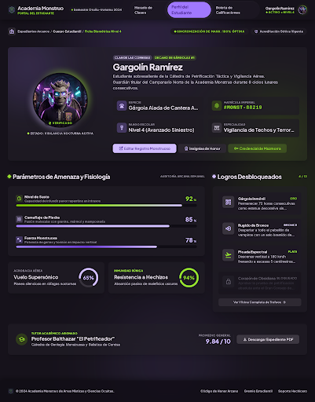
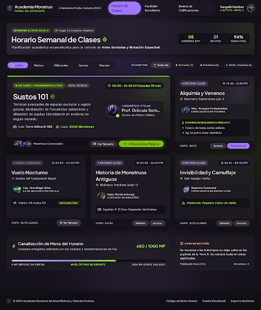
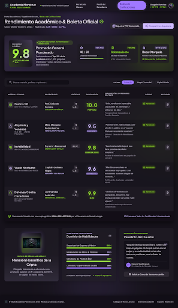

# Academia Monstruo Portal

**Integrantes del equipo:**
- Anthony Stiven Menjívar Guardado
- José Santos Córdoba Córdoba
- Adonay Antonio Zamora Navas

## Descripción del proyecto

**Academia Monstruo Portal** es un sitio web estático que representa el portal estudiantil de la Academia Monstruo de Artes Místicas y Ciencias Ocultas. Su temática combina la vida académica con un universo de gárgolas, vampiros, alquimia y ciencias ocultas.

Desde una portada se accede a tres pantallas: el perfil del estudiante Gargolín Ramírez, su horario de clases y una boleta de calificaciones. Los textos, indicadores y registros académicos son datos ficticios incluidos en el HTML.

El objetivo de la actividad fue llevar una idea y sus diseños de Google Stitch a un proyecto web navegable, utilizando el servidor MCP de Stitch y OpenCode como apoyo para adaptar las pantallas a código.

## Historia del proyecto

1. **Conexión e ideación con Stitch MCP.** Primero se conectó el servidor MCP de Google Stitch en OpenCode. Con esta integración se generó la idea central del proyecto y se definieron las pantallas de un portal académico para monstruos.
2. **Diseño de las vistas.** La propuesta se concretó en el perfil del estudiante, el horario de clases y la boleta de calificaciones, con una identidad visual oscura y acentos violetas y verdes.
3. **Construcción del sitio.** Los diseños de Stitch se utilizaron como base para construir las páginas HTML, adaptar su contenido y organizar la navegación desde una portada común. El repositorio incluye el comando `/importar-vista`, que describe el flujo de consulta de pantallas mediante el MCP, descarga del HTML y adaptación a `views/`.
4. **Desarrollo con apoyo de IA.** OpenCode se utilizó como par técnico para generar y adaptar código; el estudiante o el equipo revisó y ajustó las sugerencias durante el desarrollo.

Esta secuencia recoge el contexto de la actividad proporcionado por el equipo y la organización observable en los archivos. El modelo LLM utilizado durante el desarrollo no está identificado en la documentación del proyecto.

## Tecnologías utilizadas

### Aplicación

| Tecnología o recurso | Uso en el proyecto |
|---|---|
| HTML5 | Portada, navegación, tarjetas, tablas y contenido de las tres vistas. |
| CSS3 | Estilos de la portada, degradados, transparencias, transiciones y adaptación del diseño a distintos tamaños de pantalla. |
| Tailwind CSS por CDN | Estilos utilitarios de las vistas, con configuración de colores, tipografía y espaciados dentro de cada HTML. |
| JavaScript nativo | Filtros, búsqueda, selección visual de días, animación de barras y avisos temporales. |
| Google Fonts | Fuentes Inter y Plus Jakarta Sans. |
| Material Symbols Outlined | Iconos de las pantallas académicas. |
| SVG integrado e imágenes PNG | Indicadores gráficos y capturas locales utilizadas como vistas previas. |

### Herramientas de diseño y desarrollo

| Herramienta | Función |
|---|---|
| Google Stitch | Ideación y diseño de las pantallas de la actividad. |
| Servidor MCP de Stitch | Conexión entre OpenCode y los proyectos y pantallas de Stitch. |
| OpenCode | Asistencia de IA para convertir los diseños en código y realizar ajustes. |
| Git y Conventional Commits | Gestión de cambios y convención de mensajes definida para el equipo. |

La aplicación se abre directamente en el navegador: no requiere instalar paquetes del proyecto ni ejecutar una compilación. Los archivos de paquetes presentes en `.opencode/` pertenecen a las herramientas del agente, no al funcionamiento del portal.

## Cómo está construido

- **Portada:** `index.html` contiene los estilos CSS de su propia presentación y tres tarjetas con capturas y enlaces a las vistas.
- **Vistas independientes:** cada archivo de `views/` es una página HTML completa, con configuración de Tailwind y estilos integrados. Los scripts de interacción también están incluidos en las páginas que los utilizan; no hay carpetas compartidas de CSS o JavaScript en la implementación actual.
- **Navegación:** las páginas se enlazan con rutas relativas. Desde la portada se accede a las tres vistas y estas incluyen navegación entre pantallas y regreso al inicio.
- **Contenido:** los datos del estudiante, docentes, materias y calificaciones están escritos en el HTML. Las interacciones modifican la presentación en el navegador, sin guardar cambios ni consultar un servidor de datos.
- **Recursos gráficos:** `views/img/` almacena las tres capturas de las pantallas. Los avatares, emblemas y otras imágenes de las vistas se cargan desde direcciones remotas de Google.
- **Diseño visual:** predominan los fondos oscuros, las superficies translúcidas, los brillos y las tarjetas con bordes redondeados. Las vistas usan violeta claro (`#d0bcff`), verde (`#94de2d`) y superficies oscuras (`#16121b`), con Inter para texto y Plus Jakarta Sans para títulos.

## Estructura del proyecto

```text
.
├── index.html                       # Portada y acceso a las tres vistas
├── views/
│   ├── perfil-estudiante.html       # Ficha de Gargolín Ramírez
│   ├── horario-clases.html          # Horario y filtros por estado
│   ├── boleta-calificaciones.html   # Tabla de notas, búsqueda y avisos
│   └── img/
│       ├── perfil-estudiante.png
│       ├── horario-clases.png
│       └── boleta-calificaciones.png
├── .opencode/
│   └── commands/
│       └── importar-vista.md        # Instrucciones del comando /importar-vista
├── .githooks/
│   └── commit-msg                   # Validación opcional de Conventional Commits
├── docs/                            # Carpeta reservada para documentación adicional
├── opencode.json                    # Configuración de OpenCode y del MCP de Stitch
├── AGENTS.md                        # Reglas de trabajo para el agente
├── CONTRIBUTING.md                  # Roles y flujo de colaboración sugeridos
├── README.md                        # Documentación del proyecto
└── LICENSE                          # Licencia MIT
```

El árbol resume los archivos relevantes del portal y su flujo de desarrollo. Actualmente `docs/` solo contiene un archivo de reserva; no hay un documento `DESIGN.md`.

## Vistas y funcionalidades

| Pantalla | Contenido | Comportamiento implementado |
|---|---|---|
| [Portada](index.html) | Presentación de la academia y tarjetas con capturas de las tres vistas. | Enlaces a las pantallas y efectos visuales al pasar el cursor. |
| [Perfil del estudiante](views/perfil-estudiante.html) | Identidad de Gargolín Ramírez, especie, matrícula, especialidad, atributos, logros y tutor académico. | Animación inicial de las barras de atributos y efectos visuales en tarjetas y botones. |
| [Horario de clases](views/horario-clases.html) | Cinco materias con horarios, docentes, aulas, cupos e indicadores ficticios de mana. | Filtrado por estado: todas, en curso, próximas o tarde/inactiva. El selector de días cambia el resaltado del día elegido. |
| [Boleta de calificaciones](views/boleta-calificaciones.html) | Cinco materias con docentes, créditos, notas, comentarios y resumen académico. | Búsqueda sobre el texto de las filas, filtros por grupos de materias y notificaciones temporales para varias acciones. |

### Alcance de las interacciones

- El selector de días del horario cambia su apariencia, pero mantiene las mismas materias.
- En la boleta, la búsqueda y los filtros de categoría actualizan las filas de forma independiente: la última acción determina qué filas se muestran.
- Los botones de exportar PDF, certificados, descarga por lote y compartir de la boleta muestran avisos de demostración. No generan archivos ni publican contenido.
- Acciones como editar el perfil, descargar su expediente, consultar temarios, unirse al aula o solicitar una carta de recomendación forman parte de la interfaz visual y no tienen una operación asociada en el código actual.

## Cómo abrir o ejecutar el proyecto

### Opción 1: abrir directamente

1. Descarga o clona el repositorio.
2. Abre [index.html](index.html) con doble clic en un navegador moderno.
3. Utiliza las tarjetas para recorrer las tres vistas.

Las rutas relativas y los scripts clásicos permiten abrir el sitio con `file://`.

### Opción 2: usar un servidor local

Si tienes Node.js y npm disponibles, abre una terminal en la raíz del proyecto y ejecuta:

```bash
npx serve .
```

Abre la dirección que indique la terminal, normalmente `http://localhost:3000`. `npx` puede solicitar descargar `serve` si no está disponible en tu entorno.

### Conexión a Internet y recursos externos

Para visualizar las pantallas con sus estilos, fuentes e imágenes remotas se necesita conexión a Internet:

- Tailwind CSS se carga desde `cdn.tailwindcss.com` en las tres vistas.
- Las fuentes y los iconos se obtienen de Google Fonts.
- Los avatares y emblemas se cargan desde `lh3.googleusercontent.com`.

Las capturas de `views/img/` están guardadas localmente. Abrir el portal no requiere OpenCode, una cuenta de Stitch ni su clave de API; esas herramientas corresponden al proceso de diseño y desarrollo.

## Capturas de pantalla

### Perfil del estudiante



### Horario de clases



### Boleta de calificaciones



## Aprendizajes de la actividad

- **Integración de herramientas con MCP:** conectar OpenCode con Stitch para trabajar con los diseños desde el entorno del agente.
- **Del diseño al código:** adaptar pantallas a documentos HTML completos y organizar sus recursos y enlaces.
- **Coherencia visual:** mantener tipografías, colores y componentes relacionados entre distintas páginas.
- **Interacciones en el navegador:** utilizar JavaScript nativo para filtrar contenido, buscar en tablas y comunicar acciones con avisos.
- **Revisión humana de la IA:** validar las sugerencias del agente y distinguir la apariencia de una función de su implementación real.
- **Colaboración:** organizar el trabajo con las convenciones del repositorio y mensajes de commit descriptivos.

## Colaboración y Conventional Commits

Las reglas del agente están en [AGENTS.md](AGENTS.md), y los roles y el flujo sugerido del equipo se describen en [CONTRIBUTING.md](CONTRIBUTING.md).

Los mensajes de commit siguen el formato `tipo(alcance): descripción`:

| Tipo | Uso | Ejemplo |
|---|---|---|
| `feat` | Incorporar una vista o funcionalidad. | `feat(views): agrega vista horario-clases` |
| `fix` | Corregir un comportamiento o enlace. | `fix(views): corrige enlace a la portada` |
| `style` | Ajustar la presentación visual. | `style(views): ajusta espaciado del perfil` |
| `docs` | Actualizar documentación. | `docs(readme): documenta Academia Monstruo Portal` |
| `refactor` | Reorganizar código sin cambiar su comportamiento. | `refactor(views): reorganiza estilos del horario` |
| `chore` | Mantener la configuración y herramientas. | `chore: actualiza reglas del repositorio` |

El repositorio incluye un hook opcional en `.githooks/commit-msg` para validar estos mensajes.

## Solución de problemas

| Situación | Qué revisar |
|---|---|
| Las vistas aparecen sin estilos o con iconos incorrectos. | Comprueba el acceso a Tailwind por CDN y Google Fonts; estos recursos necesitan Internet. |
| No se ven los avatares o emblemas. | Comprueba la conexión y la disponibilidad de las imágenes remotas de Google. |
| Una captura local o un enlace a una vista no carga. | Conserva la estructura de carpetas al mover o descargar el proyecto. |
| Un botón solo muestra un aviso o no ejecuta una operación. | Consulta el alcance de las interacciones: varias acciones son demostraciones visuales. |
| El MCP devuelve un error de autenticación al continuar el desarrollo. | `STITCH_API_KEY` debe estar definida como variable de entorno del sistema en la terminal desde la que se abre OpenCode y contener una clave válida de Stitch. Según las instrucciones del repositorio, OpenCode obtiene la clave del entorno, no de un archivo `.env`. Reinicia la terminal y OpenCode si acabas de definirla de forma persistente. |

## Créditos y licencia

- **Diseño:** [Google Stitch](https://stitch.withgoogle.com/).
- **Integración y apoyo técnico de IA:** [OpenCode](https://opencode.ai/) y el servidor MCP de Stitch, con revisión del estudiante o del equipo.
- **Tipografías e iconos:** Google Fonts y Material Symbols Outlined.
- **Base del repositorio:** se conserva la atribución de Ronald Mejia incluida en la licencia.

Este repositorio incluye la [licencia MIT](LICENSE), con la atribución **Copyright (c) 2026 Ronald Mejia**.
